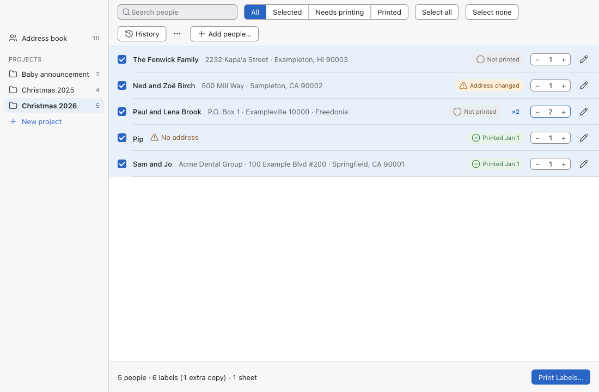
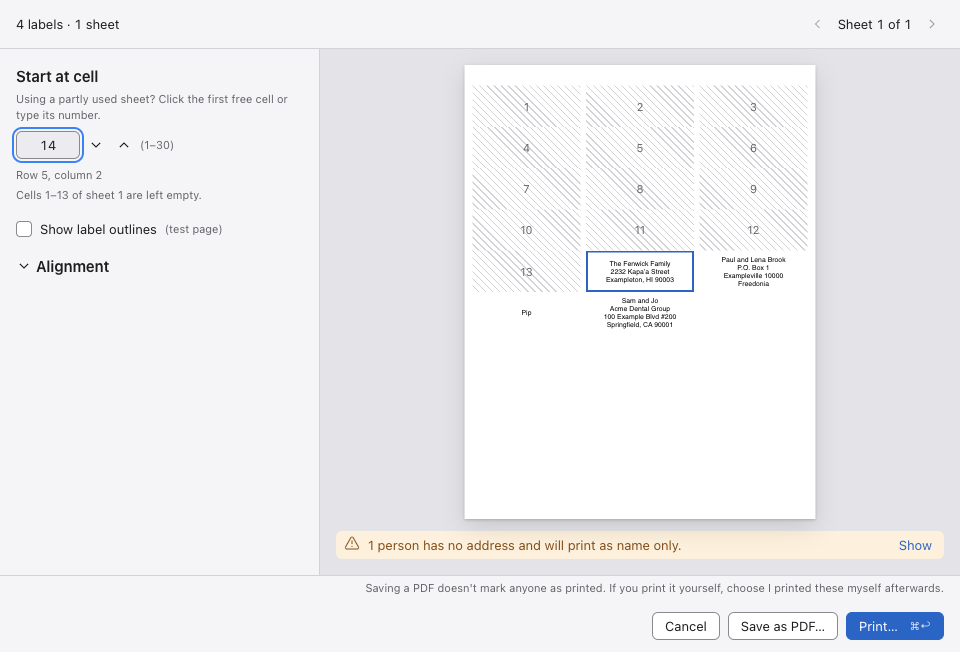

# Address Labels

A small macOS app that keeps an address book and prints **Avery 5260** label sheets (30-up, 1" × 2⅝"),
including onto a **partly used sheet**: choose which cell to start from and the first free cell is where
printing begins.



## Features
- **Address book** with search, versioned addresses (a move adds a new version, so the old one is kept),
  and people with no address (printed as name only).
- **Projects**: named mailings such as "Christmas 2026". Pick recipients from the address book, set copies per
  recipient, or start a project as a copy of an earlier one.
- **Print tracking**: each project remembers what was printed, flags people whose address changed since, and
  lets you undo a run, or just the labels that didn't come out. Saving a PDF never marks anyone as printed.
- **One sheet at a time** for hand-fed printers, with a **start cell** chosen in the print dialog
  (it resets to cell 1 each time, so no sheet state is kept).
- **On hold**: mark someone as needing an address update. They are skipped when printing in every project.
- **Alignment test**: *File ▸ Print Alignment Test Page…* prints 30 dummy labels with outlines (no data needed, nothing recorded) so you can check your printer on plain paper.
- **Quick selection**: click anywhere on a row to tick it, **Select all** skips on-hold and already-printed people, and **Esc** un-ticks everyone (with Undo). Recipients start unticked.
- **Archive** a finished project to freeze it as a read-only snapshot.
- **Print preview**, text that **shrinks to fit** the label (12 pt down to 7 pt), light and dark themes, and
  rolling backups of your data.



## Requirements
macOS, and a recent Node.js (developed on 22) to run from source. Printer alignment depends on your printer; see
[docs/calibration-checklist.md](docs/calibration-checklist.md).

## Run it
```
npm install
npm start
```

## Where your data lives
| How you run it | Data folder |
| --- | --- |
| Packaged app (`Address Labels.app`) | `~/Library/Application Support/Address Labels` |
| `npm start` (development) | the project folder itself |
| Anything, with `ADDRESS_LABELS_DATA=/some/folder` | that folder |

Use **File ▸ Show Data Folder in Finder** to see it. The folder holds `addresses.json`, `projects.json`,
`settings.json`, `backups/` (rolling, 20 per file) and `logs/`. These files are in `.gitignore`, but to keep
real addresses out of the repo entirely, run development builds against a folder elsewhere:
```
ADDRESS_LABELS_DATA=~/Documents/address-data npm start
```
The packaged app and `npm start` use **separate** data folders unless you point them at the same one. On first
run the app offers to import `~/Documents/addresses/addresses.json` if it exists.

### Data format
`addresses.json` is a list of people. Each has an `id` (a UUID, added automatically) and a list of address versions;
the highest `version` is the current one. An empty `address` list is allowed.
```json
[
  {
    "id": "3f1c2a9e-0000-4000-8000-000000000001",
    "name": "The Alder Family",
    "address": [
      { "line1": "3008 Sample Lane", "line2": "Exampleton, TX 70001", "version": 1 }
    ]
  },
  {
    "id": "3f1c2a9e-0000-4000-8000-000000000002",
    "name": "Sam and Jo",
    "address": [
      { "line1": "100 Example Blvd", "line2": "Springfield, CA 90001", "version": 1 },
      { "line1": "7 New Street", "line2": "Springfield, CA 90001", "version": 2 }
    ]
  },
  { "id": "3f1c2a9e-0000-4000-8000-000000000003", "name": "Pip", "address": [] }
]
```
Names that start with "The" sort without it. Two people may share a name; they are separate entries.

## Build the app
```
npm run package          # creates dist/Address Labels-darwin-arm64/Address Labels.app
```
The app is **unsigned**. The first time, right-click it in Finder and choose **Open**, then **Open** again.
The package excludes personal data files.

## Tests
```
npm test                 # unit tests (no Electron)
npm run test:coverage    # unit tests + 90% line gate on src/shared
npm run test:e2e         # drives the real app, in parallel (needs poppler for PDF checks: brew install poppler)
npm run package && npx playwright test --config test/e2e/playwright.config.js packaged.spec.js
```
Each e2e test gets its own data folder and Electron user-data folder, so they run in parallel. The test data
is fictional (`test/fixtures`). Visual baselines (`test/e2e/visual.spec.js-snapshots`) are machine-specific;
regenerate them with `--update-snapshots` if fonts or display scale differ.

## Layout
- `src/shared` pure logic: geometry, text fitting, layout, people model, projects, settings (unit tested)
- `src/main` Electron main process: windows, menu, files, print/PDF
- `src/renderer` main window, print dialog, output page, design tokens

## License
[PolyForm Noncommercial 1.0.0](LICENSE): free for personal, hobby, educational and other noncommercial use.
Commercial use is not permitted. Note this is not an OSI-approved "open source" license.
